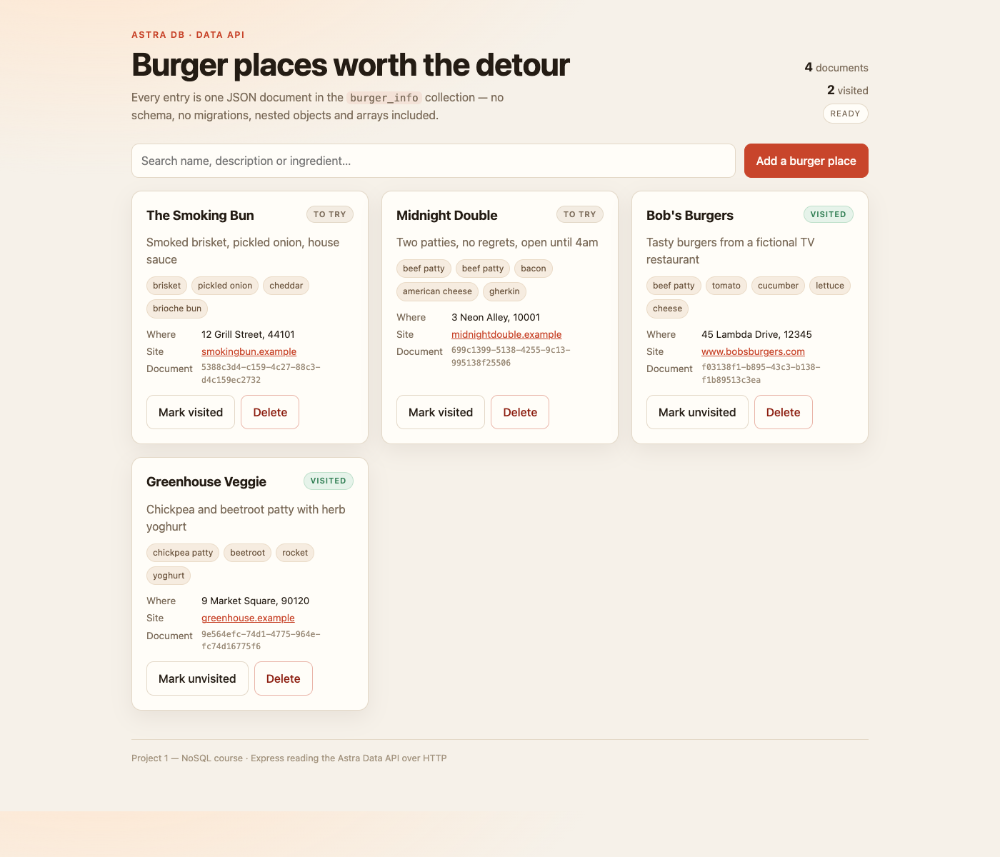

# NoSQL Burgers — Astra DB project (collections + Data API)

Course project for the freeCodeCamp **Learn NoSQL in 3 Hours** course (Ania Kubów),
**Project 1 — the document/database API project**.

A small full-stack app that lists your favourite burger restaurants. The data lives
as JSON documents in an Apache Cassandra / Astra DB **collection**, and is read and
written over HTTP with JSON commands — no CQL, no fixed schema, no SQL

```
React (Vite)  ──►  Express API (:8000)  ──►  Astra DB Data API  ──►  collection "burger_info"
```



_Real output: four documents read from the `burger_info` collection over the Data API._

> **Note on the API name.** The 2021 course uses the *Document API*
> (`/api/rest/v2/namespaces/...`, header `x-cassandra-token`), which newer Astra DB
> Serverless databases no longer expose. The current equivalent is the **Data API**
> (`/api/json/v1/<keyspace>/<collection>`, header `Token:`, every request a POST
> carrying a JSON command such as `find` / `insertOne`). `server/astra.js` uses the
> Data API; the concepts the course teaches (schemaless documents, nested objects,
> arrays, no migrations) are identical.

## What it demonstrates

| NoSQL concept | Where |
| --- | --- |
| Schemaless documents | each restaurant is one JSON document, no migrations |
| Nested objects | `location: { address, zip, website }` inside a document |
| Arrays | `ingredients: ["beef patty", "cheese", ...]` |
| Booleans / mixed types | `visited: true`, `zip` as an integer |
| Data API over Cassandra | `server/astra.js` — POST + `Token:` header, JSON commands |
| CRUD without SQL | `GET/POST/PUT/DELETE /burgers` |

## Layout

```
server/          Express API + Astra Data API client + seed script
client/          React app (Vite) that consumes the API
.env.example     copy to .env and fill in your Astra credentials
```

## 1. Create the database (Astra DB)

1. Sign in at <https://astra.datastax.com> and create a **Serverless (non-vector)**
   database. Pick the keyspace name `burgers` in the create form.
2. Copy the database's **API endpoint** (Database Details / Connection details):
   `https://<DATABASE_ID>-<REGION>.apps.astra.datastax.com`
3. Generate an **Application Token** (Connection details → Generate Token, or
   Settings → Tokens) with the *Database Administrator* role.
4. The collection itself is created by `npm run seed` (it issues the Data API
   `createCollection` command). You can also create it by hand in the portal's
   **Data Explorer**.

You do *not* need to create tables or schemas.

## 2. Configure

```bash
cp .env.example .env
```

```ini
ASTRA_API_ENDPOINT=https://<db-id>-<region>.apps.astra.datastax.com
ASTRA_KEYSPACE=burgers
ASTRA_COLLECTION=burger_info
ASTRA_TOKEN=AstraCS:...
PORT=8000
```

`.env` is git-ignored — never commit the token.

## 3. Install and run

```bash
npm run install:all     # installs server + client dependencies
npm run seed            # creates the collection and writes 4 starter documents
npm run server          # terminal 1 — API on http://localhost:8000
npm run client          # terminal 2 — UI on http://localhost:5173
```

Open <http://localhost:5173>.

### Single-port mode (what to show for review)

```bash
npm run build           # builds the React app into client/dist
npm run serve           # Express serves the API *and* the built UI
```

Open <http://localhost:8000> — one process, one port, no Vite proxy involved.
The dev pair above is only needed while editing the front end.

### Running without a database

For UI work the API falls back to an in-memory store when `ASTRA_API_ENDPOINT` is
empty, or when `USE_MOCK=1` is set. The response shapes are identical, so the front
end needs no changes:

```bash
USE_MOCK=1 npm run server
```

`/health` reports which mode is active, e.g. `{"ok":true,"mode":"astra"}`.

## API

| Method | Path | Body | Result |
| --- | --- | --- | --- |
| `GET` | `/health` | – | `{ ok, mode }` |
| `GET` | `/burgers` | – | array of documents |
| `GET` | `/burgers/:id` | – | one document |
| `POST` | `/burgers` | document JSON | `{ documentId }` |
| `PUT` | `/burgers/:id` | document JSON | updated document |
| `DELETE` | `/burgers/:id` | – | `204` |

The Data API commands behind those routes (all `POST` to
`<endpoint>/api/json/v1/burgers/burger_info`):

| Route | Command sent |
| --- | --- |
| `GET /burgers` | `{"find": {"filter": {}, "options": {"limit": 100, "skip": n}}}` |
| `GET /burgers/:id` | `{"findOne": {"filter": {"_id": "<id>"}}}` |
| `POST /burgers` | `{"insertOne": {"document": {…}}}` |
| `PUT /burgers/:id` | `{"updateOne": {"filter": {"_id": "<id>"}, "update": {"$set": {…}}}}` |
| `DELETE /burgers/:id` | `{"deleteOne": {"filter": {"_id": "<id>"}}}` |

Example document:

```json
{
  "name": "Bob's Burgers",
  "description": "Tasty burgers from a fictional TV restaurant",
  "ingredients": ["beef patty", "tomato", "cucumber", "lettuce", "cheese"],
  "visited": true,
  "location": {
    "address": "45 Lambda Drive",
    "zip": 12345,
    "website": "https://www.bobsburgers.com"
  }
}
```

## Notes

- Node 18+ only: the API uses the built-in `fetch`, so `node-fetch` (used in the
  video) is not needed.
- The video uses Create React App; this repo uses Vite, which is the current
  recommended React toolchain. Same app, faster dev server.
- `USE_MOCK=1` is for development only — the submitted version runs against Astra.
- Data API reference: <https://docs.datastax.com/en/astra-db-serverless/api-reference/dataapiclient.html>
